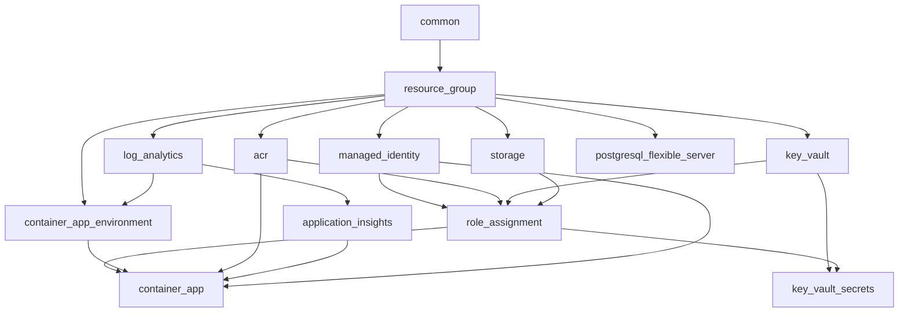

# Development Environment Integration Review

Review date: 2026-08-03  
Scope: `environments/dev` composition against all reusable platform modules.

---

## 1. Integration Review Report

### Composition Summary

The Development environment composes **13 reusable modules** with **zero direct Azure resource blocks**. All naming, tagging, and location flow through `module.common`.

| Module | Purpose | Key Inputs From |
|--------|---------|-----------------|
| `common` | Naming, tags, metadata | Root variables |
| `resource_group` | Platform RG | `common` |
| `log_analytics` | Central logging | `common`, `resource_group` |
| `application_insights` | Telemetry | `log_analytics.workspace_resource_id` |
| `managed_identity` | Workload identity | `common`, `resource_group` |
| `acr` | Container registry | `common`, `resource_group` |
| `key_vault` | Secrets store | `common`, `resource_group` |
| `storage` | Blob storage | `common`, `resource_group` |
| `postgresql_flexible_server` | Database | Sensitive vars, `common` |
| `container_app_environment` | CAE | `log_analytics.workspace_resource_id` |
| `role_assignment` | RBAC | `locals.role_assignments` |
| `key_vault_secrets` | Secret provisioning | `key_vault`, sensitive vars |
| `container_app` | API workload | ACR, MI, CAE, App Insights |

### Checklist Results

| Check | Result | Notes |
|-------|--------|-------|
| Module dependency order | **Pass** | Foundation → data → compute → RBAC → secrets → app |
| Output → input wiring | **Pass** | Workspace IDs, ACR login, MI IDs correctly chained |
| Circular dependencies | **None** | Locals reference modules; no module references back to root locals |
| Provider inheritance | **Pass** | Providers only in `providers.tf`; `subscription_id` set |
| Backend configuration | **Pass** | Partial config + `backend.hcl.example` |
| Variable flow | **Pass** | Secrets marked sensitive; no hardcoded production values |
| Locals | **Pass** | RBAC and container image derived in `locals.tf` |
| Naming consistency | **Pass** | All names via `module.common.resource_names` |
| Tag propagation | **Pass** | `module.common.tags` on every module |
| Resource dependencies | **Pass** | Explicit `depends_on` on RBAC/secrets/App Insights paths |
| Lifecycle configuration | **Pass** | Delegated to modules (e.g. container-app secret ignore) |
| Module interfaces | **Pass** | Minimal root variables; modules accept required inputs only |

### Dependency Graph

---

## 2. Identified Issues

### Critical (Fixed)

| # | Issue | Impact |
|---|-------|--------|
| C1 | **Provider version mismatch** — modules use azurerm v5 attributes; environments pinned `~> 4.0` | `terraform validate` failed |
| C2 | **`_schema_test.tf` in container-app module** pinned `azurerm ~> 4.0` | `terraform init` failed with conflicting constraints |

### High (Fixed)

| # | Issue | Impact |
|---|-------|--------|
| H1 | **Missing deployer RBAC** for Key Vault secret writes | `key_vault_secrets` apply would fail under RBAC-enabled vault |
| H2 | **Secrets module ordering** — no `depends_on` role_assignment | Race condition on first apply |

### Medium (Fixed / Documented)

| # | Issue | Impact |
|---|-------|--------|
| M1 | **Over-privileged storage RBAC** (`Storage Blob Data Contributor`) | Least-privilege violation for dev |
| M2 | **Unused `local.subscription_id`** | TFLint warning |
| M3 | **Backend placeholders inline** | Blocked partial `-backend-config` pattern |

### Operational (Not Code Defects)

| # | Issue | Action Required |
|---|-------|-----------------|
| O1 | **`terraform plan` requires backend init** in TF ≥ 1.13 when `backend "azurerm"` is declared | Bootstrap state storage; `terraform init -backend-config=backend.hcl` |
| O2 | **Azure authentication** not configured locally | OIDC or service principal for apply |
| O3 | **Container image** must exist in ACR before app starts | Push image post-ACR creation |
| O4 | **PostgreSQL firewall rules** not composed | App cannot reach DB until firewall module added |
| O5 | **Checkov HIGH/CRITICAL findings** (23 checks) | Module-level hardening deferred for dev cost; promote controls in stage/prod |

---

## 3. Recommended Improvements

1. **Set `deployment_principal_id`** in GitHub Actions environment secrets to the OIDC service principal object ID.
2. **Bootstrap remote state** using `backend.hcl.example` before first apply.
3. **Add PostgreSQL firewall module** (or `azurerm_postgresql_flexible_server_firewall_rule`) when the API needs database connectivity.
4. **Wire Container App secrets** from Key Vault via `secret` blocks once the application is ready (currently secrets are stored but not referenced by the app).
5. **Update `terraform-plan.yml`** to use `-backend-config` from GitHub environment secrets instead of `-backend=false` (plan cannot run without backend in TF 1.13).
6. **Align stage/prod `providers.tf`** with dev by adding `subscription_id = var.subscription_id`.
7. **Add Checkov skip annotations** or module hardening in stage/prod promotion path for private endpoints, purge protection, and geo-redundancy.

---

## 4. Required Code Changes (Applied)

| File | Change |
|------|--------|
| `environments/dev/versions.tf` | `azurerm ~> 5.0` |
| `environments/stage/versions.tf` | `azurerm ~> 5.0` |
| `environments/prod/versions.tf` | `azurerm ~> 5.0` |
| `modules/container-app/_schema_test.tf` | `azurerm ~> 5.0` (constraint alignment) |
| `environments/dev/locals.tf` | RBAC assignments; removed unused local |
| `environments/dev/variables.tf` | Added `deployment_principal_id` |
| `environments/dev/main.tf` | `key_vault_secrets` depends on `role_assignment` |
| `environments/dev/backend.tf` | Partial backend config |
| `environments/dev/backend.hcl.example` | **New** — backend init values |
| `environments/dev/terraform.tfvars.example` | Documented `deployment_principal_id` |
| `environments/dev/README.md` | Updated deployment flow and inputs |
| `docs/terraform/provider-inheritance.md` | `azurerm ~> 5.0` |
| `README.md` | `azurerm ~> 5.0` |

---

## 5. Optional Enhancements

| Enhancement | Benefit | Cost Impact |
|-------------|---------|-------------|
| PostgreSQL firewall rule for Azure services | Enable app → DB connectivity | None |
| Container App Key Vault secret refs | Runtime secret injection without env vars | None |
| ACR retention / quarantine policies | Supply-chain security (Checkov CKV_AZURE_166+) | Minimal |
| Budget module composition | Cost alerts near $150 target | None |
| Stop/start PostgreSQL for dev (manual or automation) | Reduce largest fixed cost | Saves ~$12/mo when stopped |
| Private endpoints (stage/prod) | Network isolation | Significantly higher cost |

---

## Validation Results

| Tool | Status | Notes |
|------|--------|-------|
| `terraform fmt -recursive -check` | **Pass** | |
| `terraform validate` (TF 1.13, azurerm 5.0.1) | **Pass** | |
| `terraform plan` | **Blocked locally** | Requires backend bootstrap + Azure auth |
| `tflint --recursive` | **Pass (warnings)** | Module-level `required_version` warnings expected by design |
| `checkov` (dev) | **23 findings** | Module hardening policies; acceptable for cost-optimized dev |
| `tfsec` | **Not run locally** | Runs in CI (`terraform-security.yml`) |
| `terraform-docs` | **CI gate** | Module README generation in pipeline |

---

## Cost Estimate (Dev, Idle / Scale-to-Zero)

| Resource | Approx. Monthly |
|----------|-----------------|
| PostgreSQL B1ms (24/7) | $12–15 |
| ACR Basic | ~$5 |
| Key Vault | ~$0–1 |
| Storage (minimal) | ~$1–2 |
| Log Analytics (1 GB/day cap) | ~$0–5 |
| Container Apps (scale 0–3) | ~$0 idle |
| Application Insights (50% sampling) | ~$0–5 |
| **Estimated total (idle)** | **~$20–30** |

Well within the **$150/month** target for a single-user dev environment.

---

## Security Posture

- User-assigned managed identity for ACR pull and Key Vault read
- ACR admin account disabled
- RBAC-enabled Key Vault with least-privilege role assignments
- Sensitive variables and outputs correctly marked
- No production secrets in source control
- Purge protection disabled in dev (intentional for easy teardown)

---

## Promotion Readiness

The dev composition pattern is suitable for promotion to stage/prod by:

1. Copying module blocks from `environments/dev/main.tf`
2. Adjusting sizing (PostgreSQL SKU, retention, sampling)
3. Enabling purge protection and private endpoints in prod
4. Setting `deployment_principal_id` per environment in CI
5. Adding PostgreSQL firewall and network controls
