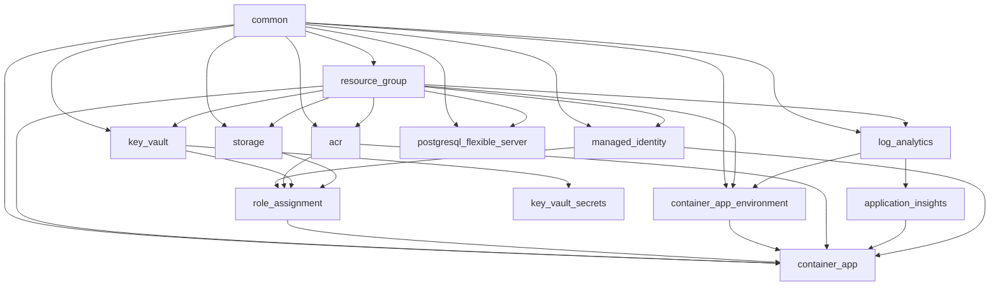

# Development Environment

Terraform root module for the **dev** environment. Composes all reusable platform modules — no Azure resources are defined directly in this root module.

## Architecture

```
environments/dev/
    module "common"                     ──▶ naming, tags, location
    module "resource_group"
    module "log_analytics"
    module "application_insights"       ──▶ workspace-linked telemetry
    module "managed_identity"           ──▶ workload identity
    module "acr"
    module "key_vault"
    module "storage"
    module "postgresql_flexible_server"
    module "container_app_environment"
    module "role_assignment"            ──▶ AcrPull, KV Secrets User, Storage Blob
    module "key_vault_secrets"
    module "container_app"              ──▶ API workload
```

## Module Dependency Graph



## Configuration

| File | Purpose |
|------|---------|
| `versions.tf` | Terraform `>= 1.13.0` and provider version constraints |
| `backend.tf` | Remote state backend (partial config — values via `backend.hcl`) |
| `backend.hcl.example` | Example backend config for `terraform init -backend-config=backend.hcl` |
| `providers.tf` | Provider configuration with `subscription_id` |
| `variables.tf` | Environment-specific input variables |
| `locals.tf` | Resource naming batch and derived values |
| `main.tf` | Module composition |
| `outputs.tf` | Platform outputs |
| `terraform.tfvars.example` | Example variable values |

## Deployment Flow

1. Copy `terraform.tfvars.example` to `terraform.tfvars` and set `subscription_id`.
2. Supply secrets via `terraform.tfvars` (gitignored) or `TF_VAR_*` in GitHub Actions.
3. Bootstrap remote state backend (see `docs/terraform/backend-strategy.md` and `backend.hcl.example`).
4. Ensure deploying identity has subscription/RG permissions.
5. Set `deployment_principal_id` to the GitHub Actions OIDC service principal object ID so Terraform can write Key Vault secrets.
6. Push container image to ACR before Container App can start successfully.
7. Run `terraform plan` and `terraform apply`.

```bash
cd environments/dev
cp terraform.tfvars.example terraform.tfvars   # edit with your values
cp backend.hcl.example backend.hcl               # after state storage bootstrap
terraform init -backend-config=backend.hcl       # production path
# OR for validate-only (no remote state):
terraform init -backend=false
terraform validate
terraform plan -var-file=terraform.tfvars          # requires backend init + Azure auth
terraform apply -var-file=terraform.tfvars
```

## Required Inputs

| Variable | Source | Notes |
|----------|--------|-------|
| `subscription_id` | tfvars / CI | Target Azure subscription |
| `project_name` | tfvars | Naming prefix (e.g. `cch`) |
| `application_name` | tfvars | Application identifier |
| `location` | tfvars | Azure region |
| `owner`, `business_unit`, `cost_center` | tfvars | Required organizational tags |
| `postgresql_admin_password` | tfvars / `TF_VAR_*` | **Sensitive** — min 8 characters |
| `api_key_placeholder` | tfvars / CI | **Sensitive** — Key Vault placeholder |
| `deployment_principal_id` | tfvars / CI | Optional — Terraform/OIDC principal for Key Vault secret writes |

Optional: `container_image_name`, `container_image_tag`, `container_target_port`.

## Expected Outputs

| Output | Description |
|--------|-------------|
| `container_app_url` | HTTPS ingress URL |
| `container_app_environment_id` | Container Apps Environment ID |
| `acr_login_server` | ACR login server |
| `storage_account_name` | Storage account name |
| `key_vault_uri` | Key Vault URI |
| `postgresql_fqdn` | PostgreSQL server FQDN |
| `application_insights_connection_string` | App Insights connection string (sensitive) |

## Secrets Management

| Secret | Used By | Supply Via |
|--------|---------|------------|
| `postgresql_admin_password` | PostgreSQL module, Key Vault secret | `TF_VAR_postgresql_admin_password` |
| `api_key_placeholder` | Key Vault secret | `TF_VAR_api_key_placeholder` |

Never commit real secrets. GitHub Actions should inject `TF_VAR_*` from encrypted repository secrets.

## Environment Customization

Dev-specific settings are applied in `main.tf`:

| Resource | Dev Setting |
|----------|-------------|
| Log Analytics | 1 GB/day quota, 30-day retention |
| Application Insights | 50% sampling |
| ACR | Basic SKU, admin disabled |
| Key Vault | Purge protection disabled |
| PostgreSQL | Burstable `B_Standard_B1ms`, 32 GB |
| Container App | Scale 0–3, HTTP ingress, health probe |

Override module defaults in `main.tf` or promote changes to `stage`/`prod` roots as needed.

## Local Validation

```bash
cd environments/dev
terraform init -backend=false
terraform validate
terraform plan -var-file=terraform.tfvars.example
```

## Documentation

- [Terraform Foundation](../../docs/terraform/README.md)
- [Shared Foundation](../../docs/terraform/shared-foundation.md)
- [Backend Strategy](../../docs/terraform/backend-strategy.md)
- [Provider Inheritance](../../docs/terraform/provider-inheritance.md)
- [Dev Integration Review](../../docs/terraform/dev-integration-review.md)
