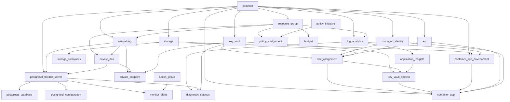

# Production Environment

Terraform root module for the **prod** environment. Composes all reusable platform modules with production sizing, full governance (policy initiatives, assignments, budgets), observability, and private networking defaults. No Azure resources are defined directly in this root module.

## Architecture

```
environments/prod/
    module "common"                      ──▶ naming, tags, required tag enforcement
    module "resource_group"              ──▶ CanNotDelete management lock
    module "networking"                  ──▶ VNet/subnets (default enabled)
    module "private_dns"                 ──▶ Private DNS zones + VNet links
    module "log_analytics"
    module "application_insights"
    module "managed_identity"
    module "acr"                         ──▶ Premium SKU, zone redundancy
    module "key_vault"                   ──▶ purge protection, private access
    module "storage"                     ──▶ GRS replication, TLS 1.2 minimum
    module "storage_containers"
    module "postgresql_flexible_server"  ──▶ GP SKU, SameZone HA, geo backup
    module "postgresql_database"
    module "postgresql_configuration"
    module "container_app_environment"
    module "private_endpoint"            ──▶ Private Link endpoints (default enabled)
    module "role_assignment"             ──▶ least-privilege workload RBAC
    module "key_vault_secrets"
    module "policy_initiative"           ──▶ custom production baseline initiative
    module "policy_assignment"           ──▶ initiative + governance assignments
    module "budget"                      ──▶ cost alerts at 70/85/100%
    module "action_group"
    module "monitor_alerts"              ──▶ elevated sensitivity thresholds
    module "diagnostic_settings"
    module "container_app"               ──▶ Key Vault secret refs, HTTPS-only ingress
```

Configuration is centralized in `locals.tf` (sizing, feature flags, governance, monitoring). Module wiring lives in `main.tf`.

## Module Dependency Graph



## Differences from Stage

| Area | Stage | Production |
|------|-------|------------|
| State file | `stage.tfstate` | `prod.tfstate` |
| VNet CIDR | `10.20.0.0/16` | `10.30.0.0/16` |
| Private networking | Optional (default off) | Default on |
| Private endpoints | Optional (default off) | Default on |
| Public PaaS access | Default on | Default off |
| ACR SKU | Standard | Premium + zone redundancy |
| Storage replication | LRS (module default) | GRS |
| PostgreSQL | B2ms, 64 GB, 14-day backup | GP D2s, 128 GB, 35-day backup, SameZone HA |
| Container App scale | 1–5 replicas | 2–10 replicas |
| App Insights sampling | 25% | 100% |
| Log Analytics | 5 GB/day, 60 days | 10 GB/day, 90 days |
| Governance | Individual policy assignments | Custom policy initiative + assignment |
| Budget thresholds | 80%, 100% forecast | 70%, 85%, 100% forecast |
| Alert CPU threshold | 80% | 70% (severity 1) |
| Container secrets | Inline App Insights | Key Vault secret reference |
| Ingress | Default secure | `allow_insecure_connections = false` explicit |

## Configuration

| File | Purpose |
|------|---------|
| `versions.tf` | Terraform `>= 1.13.0` and provider version constraints |
| `backend.tf` | Remote state backend (partial config — values via `backend.hcl`) |
| `backend.hcl.example` | Example backend config with `key = "prod.tfstate"` |
| `providers.tf` | Provider configuration with production-safe feature flags |
| `variables.tf` | Environment-specific input variables and feature flags |
| `locals.tf` | Sizing, governance, networking, monitoring, and derived values |
| `main.tf` | Module composition |
| `outputs.tf` | Platform outputs |
| `terraform.tfvars.example` | Example variable values |

## Deployment Process

1. Copy `terraform.tfvars.example` to `terraform.tfvars` and set `subscription_id`.
2. Supply secrets via `terraform.tfvars` (gitignored) or `TF_VAR_*` in GitHub Actions.
3. Bootstrap remote state backend in a **dedicated production subscription/storage account** (see `docs/terraform/backend-strategy.md`).
4. Set `deployment_principal_id` to the GitHub Actions OIDC service principal for Key Vault secret writes.
5. Configure `budget_contact_emails` and `alert_contact_emails` for governance notifications.
6. Promote a validated, immutable container image tag from stage to production ACR.
7. Run plan and apply through change-management approval:

```bash
cd environments/prod
cp terraform.tfvars.example terraform.tfvars   # edit with your values
cp backend.hcl.example backend.hcl             # after state storage bootstrap
terraform init -backend-config=backend.hcl
terraform plan -var-file=terraform.tfvars
terraform apply -var-file=terraform.tfvars
```

## Promotion Process

Production deployments follow a controlled promotion path from stage:

1. **Validate in stage** — Apply Terraform with the candidate `container_image_tag`. Run integration, load, and security tests.
2. **Soak period** — Monitor stage alerts, diagnostics, and cost for the agreed soak window (typically 24–72 hours).
3. **Change approval** — Obtain production change-management approval with linked stage deployment evidence.
4. **Image promotion** — Import or retag the validated image into production ACR. Never build a separate untested image for prod.
5. **Terraform apply** — Update `container_image_tag` in prod tfvars and apply during the approved window.
6. **Post-deploy verification** — Confirm health probes, App Insights telemetry, and alert baselines.
7. **Record** — Document applied image tag, Terraform state version, and approver in the change ticket.

Keep prod module composition aligned with stage. Environment differences must remain in `locals.tf`, feature flags, and tfvars — not module wiring changes.

## Rollback Considerations

| Scenario | Rollback Action | Notes |
|----------|-----------------|-------|
| Bad container image | Revert `container_image_tag` to last known-good tag and `terraform apply` | Fastest path; no infrastructure change |
| Terraform misconfiguration | `terraform apply` with previous tfvars/state snapshot | Requires state backup before apply |
| Database schema migration failure | Application-level rollback + point-in-time restore | PostgreSQL PITR within retention window (35 days) |
| Policy initiative blocking deploy | Temporarily assign exemption (outside Terraform) or fix non-compliance | Avoid disabling governance in prod |
| Key Vault secret corruption | Restore soft-deleted secret version in Key Vault | Purge protection prevents permanent deletion |
| Full environment failure | Redeploy from Terraform state in DR subscription | Requires cross-region state replication |

**Before every production apply:**

- Export current Terraform state (`terraform state pull > backup.tfstate`).
- Record current Container App revision and image tag.
- Confirm on-call coverage for alert action groups.

## Operational Runbooks

### Health check failure (Container App)

1. Check Container App revision status in Azure Portal or `az containerapp revision list`.
2. Query Log Analytics for application exceptions and readiness probe failures.
3. Verify ACR image exists and workload identity has `AcrPull`.
4. Roll back image tag if the revision is unhealthy.

### PostgreSQL elevated CPU/storage alerts

1. Review `cpu_percent` and `storage_percent` metrics in Azure Monitor.
2. Check slow-query logs (`log_min_duration_statement = 1000ms` in prod).
3. Scale SKU or storage via `locals.tf` sizing after capacity review.
4. Consider read replicas or query optimization before vertical scaling.

### Key Vault access denied

1. Confirm managed identity has `Key Vault Secrets User` on the vault scope.
2. Verify private endpoint DNS resolution when private networking is enabled.
3. Check diagnostic logs for authentication failures.

### Budget threshold exceeded

1. Review Cost Management breakdown by resource tag (`environment = prod`).
2. Investigate unexpected scale events (Container App replicas, PostgreSQL storage growth).
3. Adjust `budget_amount` only after finance approval.

### Policy non-compliance

1. Open Azure Policy compliance dashboard filtered to production resource group scope.
2. Remediate or request exemption with documented business justification.
3. Update initiative or assignments in `locals.tf` if baseline needs adjustment.

## Disaster Recovery Assumptions

| Component | DR Strategy | RPO / RTO Guidance |
|-----------|-------------|-------------------|
| Terraform state | Geo-redundant storage account for remote state | RPO: minutes (state blob replication) |
| PostgreSQL | Geo-redundant backup enabled; PITR within 35 days | RPO: ≤ 5 min (PITR); RTO: hours (restore + DNS) |
| Storage (GRS) | Geo-redundant storage with RA-GRS read access | RPO: ≤ 15 min; RTO: hours (failover) |
| Key Vault | Soft delete + purge protection; secrets replicated via Terraform | RPO: last apply; RTO: hours |
| Container App | Redeploy from ACR image + Terraform | RTO: minutes to hours |
| Log Analytics | 90-day retention; export to long-term archive separately | RPO: ingestion delay |

**Assumptions:**

- Production runs in a single primary Azure region (`location` tfvar). Cross-region active-active is not configured by default.
- DR failover to a secondary region requires a separate prod stack or manual region override — not automated in this composition.
- Application data in PostgreSQL must be backed up and tested independently of infrastructure DR drills.

## Security Considerations

- **Least privilege RBAC** — Workload identity receives only `AcrPull`, `Key Vault Secrets User`, and `Storage Blob Data Contributor`.
- **Managed identity** — Container App uses user-assigned identity; no admin credentials in app configuration.
- **Key Vault references** — Application Insights connection string stored in Key Vault and referenced by Container App (not inline).
- **HTTPS only** — Storage enforces HTTPS; Container App ingress disallows insecure connections.
- **Purge protection** — Key Vault purge protection enabled; provider features prevent purge-on-destroy.
- **Soft delete** — Key Vault and Log Analytics soft-delete recovery enabled in provider features.
- **Private networking** — Default private endpoints for Key Vault, Storage, ACR, and PostgreSQL.
- **Policy baseline** — Custom initiative enforces secure transfer, Key Vault soft delete, and storage network restrictions.
- **Secrets** — Never commit `postgresql_admin_password` or `api_key_placeholder`; use CI secret injection.
- **Resource lock** — `CanNotDelete` lock on production resource group prevents accidental deletion.

## Required Inputs

| Variable | Source | Notes |
|----------|--------|-------|
| `subscription_id` | tfvars / CI | Production Azure subscription |
| `project_name` | tfvars | Naming prefix (e.g. `cch`) |
| `application_name` | tfvars | Application identifier |
| `location` | tfvars | Primary Azure region |
| `owner`, `business_unit`, `cost_center` | tfvars | Required organizational tags |
| `postgresql_admin_password` | tfvars / `TF_VAR_*` | **Sensitive** — min 8 characters |
| `api_key_placeholder` | tfvars / CI | **Sensitive** — Key Vault placeholder |
| `budget_contact_emails` | tfvars | Required for budget notifications |
| `alert_contact_emails` | tfvars | Required for monitor action groups |
| `deployment_principal_id` | tfvars / CI | Recommended — Terraform/OIDC principal for Key Vault |

### Feature Flags

| Variable | Default | Description |
|----------|---------|-------------|
| `enable_private_networking` | `true` | Deploy VNet, subnets, and private DNS |
| `enable_private_endpoints` | `true` | Private endpoints for KV, Storage, ACR, PostgreSQL |
| `public_network_access_enabled` | `false` | Public access on PaaS when not VNet-integrated |
| `enable_governance` | `true` | Policy initiatives, assignments, and budgets |
| `enable_diagnostics` | `true` | Diagnostic settings to Log Analytics |
| `enable_monitoring` | `true` | Action groups and metric alerts |
| `container_ingress_external_enabled` | `true` | External HTTPS ingress for Container App |

## Expected Outputs

| Output | Description |
|--------|-------------|
| `container_app_url` | HTTPS ingress URL |
| `container_app_id` | Container App resource ID |
| `acr_login_server` | ACR login server |
| `key_vault_uri` | Key Vault URI |
| `storage_account_name` | Storage account name |
| `postgresql_fqdn` | PostgreSQL server FQDN |
| `application_insights_connection_string` | App Insights connection string (sensitive) |
| `log_analytics_workspace_id` | Log Analytics workspace resource ID |
| `policy_initiative_ids` | Custom policy initiative resource IDs |
| `resource_group_lock_id` | Management lock on platform resource group |

## Secrets Management

| Secret | Used By | Supply Via |
|--------|---------|------------|
| `postgresql_admin_password` | PostgreSQL module, Key Vault secret | `TF_VAR_postgresql_admin_password` |
| `api_key_placeholder` | Key Vault secret | `TF_VAR_api_key_placeholder` |
| App Insights connection string | Key Vault secret (auto-populated from module output) | Managed by Terraform |

Never commit real secrets. GitHub Actions should inject `TF_VAR_*` from encrypted repository secrets.

## Local Validation

```bash
cd environments/prod
terraform init -backend=false
terraform fmt -check -recursive
terraform validate
terraform plan -var-file=terraform.tfvars.example \
  -var="postgresql_admin_password=PlanOnlyP@ssw0rd!" \
  -var="api_key_placeholder=plan-only-placeholder"
```

Optional tooling (from repository root):

```bash
tflint --chdir=environments/prod
checkov -d environments/prod
terraform-docs markdown environments/prod
```

## Documentation

- [Terraform Foundation](../../docs/terraform/README.md)
- [Shared Foundation](../../docs/terraform/shared-foundation.md)
- [Backend Strategy](../../docs/terraform/backend-strategy.md)
- [Provider Inheritance](../../docs/terraform/provider-inheritance.md)
- [Stage Environment](../stage/README.md)
- [Development Environment](../dev/README.md)
