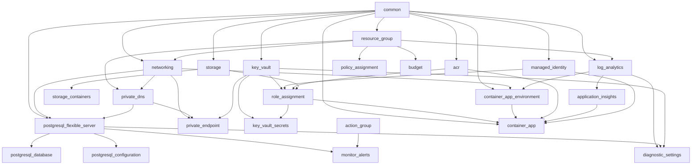

# Staging Environment

Terraform root module for the **stage** environment. Composes all reusable platform modules with production-like sizing, governance controls, and optional private networking. No Azure resources are defined directly in this root module.

## Architecture

```
environments/stage/
    module "common"                      ──▶ naming, tags, required tag enforcement
    module "resource_group"              ──▶ CanNotDelete management lock
    module "networking"                  ──▶ optional VNet/subnets
    module "private_dns"                 ──▶ optional Private DNS zones + VNet links
    module "log_analytics"
    module "application_insights"
    module "managed_identity"
    module "acr"                         ──▶ Standard SKU
    module "key_vault"                   ──▶ purge protection enabled
    module "storage"
    module "storage_containers"
    module "postgresql_flexible_server"  ──▶ GP SKU, optional VNet integration
    module "postgresql_database"
    module "postgresql_configuration"
    module "container_app_environment"
    module "private_endpoint"            ──▶ optional Private Link endpoints
    module "role_assignment"
    module "key_vault_secrets"
    module "policy_assignment"           ──▶ Azure Policy governance
    module "budget"                      ──▶ cost alerts
    module "action_group"
    module "monitor_alerts"
    module "diagnostic_settings"
    module "container_app"               ──▶ API workload
```

Configuration is centralized in `locals.tf` (sizing, feature flags, governance, monitoring). Module wiring lives in `main.tf`.

## Module Dependency Graph



## Differences from Development

| Area | Development | Stage |
|------|-------------|-------|
| Environment tag | `dev` / `stg` abbreviation | `stage` |
| State file | `dev.tfstate` | `stage.tfstate` |
| Resource lock | Disabled | `CanNotDelete` on resource group |
| Tag enforcement | Default | Required tags enforced |
| Log Analytics | 1 GB/day, 30-day retention | 5 GB/day, 60-day retention |
| Application Insights | 50% sampling | 25% sampling |
| ACR SKU | Basic | Standard |
| Key Vault | Purge protection off | Purge protection on |
| PostgreSQL | Burstable B1ms, 32 GB | GP D2s_v3, 64 GB, 14-day backup |
| PostgreSQL extras | Server only | Database + configuration modules |
| Storage | Account only | Account + blob containers |
| Container App | Scale 0–3, `latest` tag | Scale 1–5, pinned `stage` tag |
| Governance | None | Policy assignments + budget |
| Monitoring | None | Action groups, metric alerts, diagnostics |
| Private networking | Not deployed | Optional via feature flags |
| RBAC storage role | Blob Data Reader | Blob Data Contributor |

## Configuration

| File | Purpose |
|------|---------|
| `versions.tf` | Terraform `>= 1.13.0` and provider version constraints |
| `backend.tf` | Remote state backend (partial config — values via `backend.hcl`) |
| `backend.hcl.example` | Example backend config for `terraform init -backend-config=backend.hcl` |
| `providers.tf` | Provider configuration with `subscription_id` |
| `variables.tf` | Environment-specific input variables and feature flags |
| `locals.tf` | Sizing, governance, networking, monitoring, and derived values |
| `main.tf` | Module composition |
| `outputs.tf` | Platform outputs |
| `terraform.tfvars.example` | Example variable values |

## Deployment Process

1. Copy `terraform.tfvars.example` to `terraform.tfvars` and set `subscription_id`.
2. Supply secrets via `terraform.tfvars` (gitignored) or `TF_VAR_*` in GitHub Actions.
3. Bootstrap remote state backend (see `docs/terraform/backend-strategy.md` and `backend.hcl.example`).
4. Set `deployment_principal_id` to the GitHub Actions OIDC service principal for Key Vault secret writes.
5. Configure `budget_contact_emails` and `alert_contact_emails` for governance notifications.
6. Push container image tagged `stage` (or your chosen tag) to ACR before Container App starts.
7. Run plan and apply through the deployment framework or manually:

```bash
cd environments/stage
cp terraform.tfvars.example terraform.tfvars   # edit with your values
cp backend.hcl.example backend.hcl             # after state storage bootstrap
terraform init -backend-config=backend.hcl       # production path
# OR for validate-only (no remote state):
terraform init -backend=false
terraform validate
terraform plan -var-file=terraform.tfvars
terraform apply -var-file=terraform.tfvars
```

## Promotion Strategy

Stage is the pre-production gate before production:

1. **Build** — CI builds and pushes an immutable container image tag (e.g. `stage`, `1.2.3-rc1`).
2. **Deploy to stage** — Apply Terraform with pinned `container_image_tag` and validate integration tests.
3. **Soak** — Run automated and manual tests; monitor alerts and diagnostics in Log Analytics.
4. **Promote** — Copy validated tfvars overrides and image tag to `environments/prod`; apply prod with change-management approval.
5. **Drift check** — Run `terraform plan` in stage after prod promotion to confirm environments remain aligned on module versions.

Keep stage module composition aligned with prod. Environment differences should be limited to `locals.tf`, feature flags, and tfvars — not module wiring changes.

## Required Inputs

| Variable | Source | Notes |
|----------|--------|-------|
| `subscription_id` | tfvars / CI | Target Azure subscription |
| `project_name` | tfvars | Naming prefix (e.g. `cch`) |
| `application_name` | tfvars | Application identifier |
| `location` | tfvars | Azure region |
| `owner`, `business_unit`, `cost_center` | tfvars | Required organizational tags |
| `postgresql_admin_password` | tfvars / `TF_VAR_*` | **Sensitive** — min 8 characters |
| `api_key_placeholder` | tfvars / CI | **Sensitive** — Key Vault placeholder |
| `budget_contact_emails` | tfvars | Required when `enable_governance = true` |
| `alert_contact_emails` | tfvars | Required when `enable_monitoring = true` |
| `deployment_principal_id` | tfvars / CI | Optional — Terraform/OIDC principal for Key Vault |

### Feature Flags

| Variable | Default | Description |
|----------|---------|-------------|
| `enable_private_networking` | `false` | Deploy VNet, subnets, and private DNS |
| `enable_private_endpoints` | `false` | Private endpoints for KV, Storage, ACR, PostgreSQL |
| `public_network_access_enabled` | `true` | Public access on PaaS when not VNet-integrated |
| `enable_governance` | `true` | Policy assignments |
| `enable_diagnostics` | `true` | Diagnostic settings to Log Analytics |
| `enable_monitoring` | `true` | Action groups and metric alerts |
| `container_ingress_external_enabled` | `true` | External HTTPS ingress for Container App |

## Expected Outputs

| Output | Description |
|--------|-------------|
| `container_app_url` | HTTPS ingress URL |
| `container_app_environment_id` | Container Apps Environment ID |
| `acr_login_server` | ACR login server |
| `storage_account_name` | Storage account name |
| `key_vault_uri` | Key Vault URI |
| `postgresql_fqdn` | PostgreSQL server FQDN |
| `application_insights_connection_string` | App Insights connection string (sensitive) |
| `resource_group_lock_id` | Management lock on platform resource group |
| `private_networking_enabled` | Whether private networking was deployed |
| `private_endpoint_ids` | Private endpoint IDs when enabled |

## Secrets Management

| Secret | Used By | Supply Via |
|--------|---------|------------|
| `postgresql_admin_password` | PostgreSQL module, Key Vault secret | `TF_VAR_postgresql_admin_password` |
| `api_key_placeholder` | Key Vault secret | `TF_VAR_api_key_placeholder` |

Never commit real secrets. GitHub Actions should inject `TF_VAR_*` from encrypted repository secrets.

## Operational Guidance

- **Resource lock** — Stage resource group has a `CanNotDelete` lock. Remove the lock in Azure Portal only for approved teardown.
- **Private networking** — Enable `enable_private_networking` and `enable_private_endpoints` together after VNet address space is approved by networking team.
- **Policy compliance** — Review non-compliant resources in Azure Policy after apply; audit policies run in `DoNotEnforce` mode where noted.
- **Budget alerts** — Update `budget_amount` as stage workload cost profile matures.
- **Image tags** — Pin immutable tags for stage; avoid `latest` to mirror production promotion discipline.
- **Diagnostics** — Query Log Analytics workspace for Key Vault, Storage, and PostgreSQL logs after deployment.

## Local Validation

```bash
cd environments/stage
terraform init -backend=false
terraform fmt -check -recursive
terraform validate
terraform plan -var-file=terraform.tfvars.example
```

## Documentation

- [Terraform Foundation](../../docs/terraform/README.md)
- [Shared Foundation](../../docs/terraform/shared-foundation.md)
- [Backend Strategy](../../docs/terraform/backend-strategy.md)
- [Provider Inheritance](../../docs/terraform/provider-inheritance.md)
- [Development Environment](../dev/README.md)
