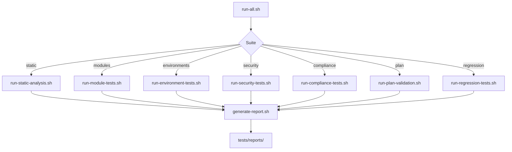
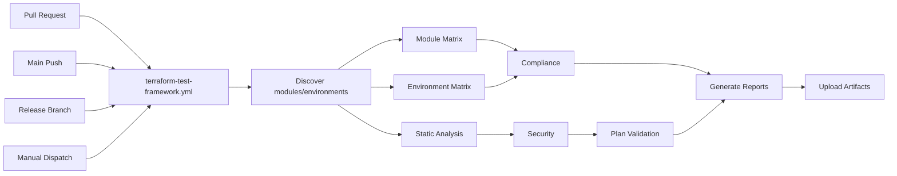

# Execution Flow

## Local Execution



## CI Execution



## Suite Dependencies

| Suite | Depends On | Produces |
|-------|------------|----------|
| Static | terraform, tflint, terraform-docs | `static-summary.md` |
| Modules | terraform | `modules-summary.md` |
| Environments | terraform | `environments-summary.md` |
| Security | checkov, tfsec, trivy (optional locally) | `security-summary.md`, scanner JSON |
| Compliance | jq, git | `compliance-summary.md` |
| Plan | terraform, jq | `plan-analysis-*.md` |
| Regression | all above | `regression-summary.md` |

## Discover Scripts

Used by CI for dynamic matrices:

```bash
./tests/scripts/discover-modules.sh --json
./tests/scripts/discover-environments.sh --github
```

## Exit Codes

| Code | Meaning |
|------|---------|
| 0 | All gates passed |
| 1 | One or more gates failed |

Terraform plan exit code `2` (changes present) is treated as success for plan validation gates.
